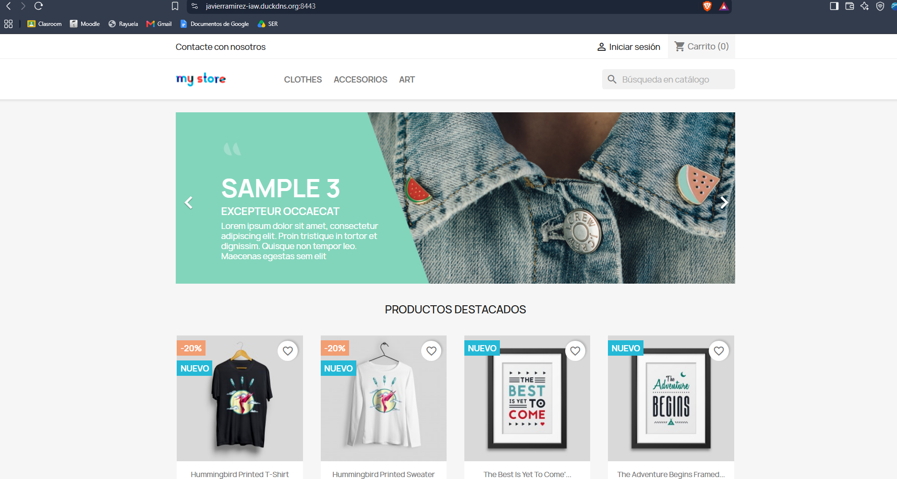

# Instalación de PrestaShop con LAMP y HTTPS en Vagrant

En esta práctica de **Implantación de Aplicaciones Web** he automatizado la instalación de **PrestaShop 8.1.7** sobre una pila **LAMP** (Apache, MySQL y PHP 8.1) usando **Vagrant** y **VirtualBox** en local, junto con **phpMyAdmin** y certificado HTTPS de **Let's Encrypt** mediante **DuckDNS**.

## Datos del entorno

| Componente | Configuración |
| :--- | :--- |
| **Sistema Operativo** | Ubuntu 22.04 LTS (`bento/ubuntu-22.04`) |
| **Máquina Virtual** | 2 CPUs, 2048 MB de RAM (`JavierRamirezPrestashop`) |
| **Puertos** | `8080 -> 80` (HTTP), `8443 -> 443` (HTTPS) |
| **Pila LAMP** | Apache 2, MySQL 8.0, PHP 8.1 y phpMyAdmin |
| **Dominio y SSL** | `javierramirez-iaw.duckdns.org` (apuntando a `127.0.0.1`) con Certbot (DNS-01) |
| **Aplicación** | PrestaShop 8.1.7 (instalado por CLI) |

## Archivos del repositorio

- `Vagrantfile`: configuración de la máquina virtual y redirección de puertos.
- `conf/000-default.conf`: VirtualHost de Apache con `AllowOverride All`.
- `scripts/install_lamp.sh`: instala Apache, MySQL, PHP 8.1 con sus extensiones, phpMyAdmin y ajusta `php.ini`.
- `scripts/setup_letsencrypt_https.sh`: genera el certificado SSL con Certbot y activa el sitio HTTPS en Apache.
- `scripts/deploy_prestashop.sh`: crea la base de datos, descarga PrestaShop y lanza la instalación por CLI.
- `images/`: capturas de la verificación final.

*(El archivo `scripts/.env` no está subido al repositorio para no exponer las contraseñas).*

## Proceso de despliegue paso a paso

### 1. Aprovisionamiento de la máquina virtual

Desde PowerShell en la carpeta del proyecto levanto la máquina y me conecto por SSH:

```powershell
vagrant up
vagrant ssh
```

La carpeta del proyecto queda sincronizada automáticamente en `/vagrant` dentro de la máquina virtual.


### 2. Instalación de la pila LAMP y phpMyAdmin

El script `scripts/install_lamp.sh` automatiza:
- Actualización de repositorios e instalación de **Apache**, **MySQL Server** y **PHP 8.1**.
- Instalación de las extensiones requeridas y recomendadas por PrestaShop (`php-mysql`, `php-curl`, `php-gd`, `php-intl`, `php-mbstring`, `php-xml`, `php-zip`, `php-bcmath`, `php-imagick`, `php-soap`).
- Instalación desatendida de **phpMyAdmin**.
- Ajuste de directivas en `/etc/php/8.1/apache2/php.ini` y `/etc/php/8.1/cli/php.ini`:
  - `memory_limit = 256M`
  - `max_input_vars = 5000`
  - `post_max_size = 128M`
  - `upload_max_filesize = 128M`
- Despliegue del VirtualHost `conf/000-default.conf` con `AllowOverride All` y habilitación de los módulos `mod_rewrite` y `mod_headers`.

```bash
sudo bash /vagrant/scripts/install_lamp.sh
```

#### Verificación de requisitos (`phppsinfo.php`) y phpMyAdmin

Para comprobar que el entorno cumple todos los requisitos de PrestaShop antes del despliegue, se descargó `phppsinfo.php` en `/var/www/html`:

```bash
sudo wget -q https://raw.githubusercontent.com/PrestaShop/php-ps-info/master/phppsinfo.php -O /var/www/html/phppsinfo.php
sudo chown www-data:www-data /var/www/html/phppsinfo.php
```

- **Comprobación de requisitos:** `http://localhost:8080/phppsinfo.php` (usuario y contraseña por defecto: `prestashop`).
- **Acceso a phpMyAdmin:** `http://localhost:8080/phpmyadmin/`.

### 3. Archivo de variables (`scripts/.env`)

Para no escribir contraseñas ni datos fijos dentro de los scripts, creé `/vagrant/scripts/.env` con esta estructura:

```bash
DOMAIN="javierramirez-iaw.duckdns.org"
CERTBOT_EMAIL="tu_correo@ejemplo.com"

DB_NAME="prestashop"
DB_USER="ps_user"
DB_PASS="CAMBIAR_PASSWORD"

PS_SHOP_NAME="Tienda Javier Ramirez"
PS_COUNTRY="es"
PS_LANGUAGE="es"
PS_ADMIN_FIRSTNAME="Javier"
PS_ADMIN_LASTNAME="Ramirez"
PS_ADMIN_EMAIL="admin@javierramirez-iaw.duckdns.org"
PS_ADMIN_PASS="CAMBIAR_PASSWORD"
```

### 4. Certificado HTTPS con Let's Encrypt y DuckDNS

Como la máquina está en local con Vagrant y no tiene IP pública en el puerto 80, usé el reto **DNS-01** de Certbot con mi subdominio de DuckDNS apuntando a `127.0.0.1`:

```bash
sudo bash /vagrant/scripts/setup_letsencrypt_https.sh
```

Al ejecutarse, Certbot muestra un código TXT para `_acme-challenge.javierramirez-iaw.duckdns.org`. Tras actualizarlo en DuckDNS y validar el certificado, el propio script habilita el módulo `ssl`, crea `/etc/apache2/sites-available/000-default-ssl.conf` y reinicia Apache.

### 5. Despliegue automatizado de PrestaShop por CLI

El script `scripts/deploy_prestashop.sh` realiza el despliegue completo sin intervención manual:
1. Crea la base de datos y el usuario específico en MySQL con las variables de `scripts/.env`.
2. Limpia `/var/www/html`, descarga **PrestaShop 8.1.7** y descomprime los archivos con propietario `www-data`.
3. Ejecuta el instalador CLI (`install/index_cli.php`) configurando el dominio con el puerto mapeado (`javierramirez-iaw.duckdns.org:8443`) y `--ssl=1`.
4. Aplica medidas de seguridad post-instalación: elimina el directorio `/var/www/html/install` y renombra `/var/www/html/admin` a `/var/www/html/admin_ps`.
5. Limpia los archivos temporales y reinicia Apache.

```bash
sudo bash /vagrant/scripts/deploy_prestashop.sh
```


## Verificación final

Tras completar todos los scripts, tanto la tienda pública como el panel de administración quedan accesibles bajo HTTPS con certificado válido:

- **Front-Office (Tienda):** `https://javierramirez-iaw.duckdns.org:8443/`
- **Back-Office (Administración):** `https://javierramirez-iaw.duckdns.org:8443/admin_ps/`





